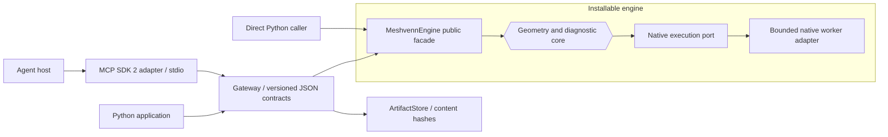

# Meshvenn engine and agent adapter

Meshvenn exposes its reusable engine through two separately installable Python
distributions. `meshvenn-engine` supplies `MeshvennEngine`; `meshvenn-agent`
supplies the versioned action Gateway, artifact storage and an optional MCP
transport. A caller chooses its model or agent host independently. Neither the
Gateway nor the MCP adapter calls an LLM provider.



The engine is the center of this hexagonal design. Transports depend on its
public facade through `EnginePort`; algorithms, native execution and uncertainty
policies remain engine responsibilities. The MCP adapter imports no `core` or
`bpy` modules. A different caller can use the same Gateway contracts without
installing MCP, or call the engine facade directly.

## Install

Use Python 3.11 or newer and a project virtual environment. Install the two
built wheels into that environment; install the agent's optional extra when an
MCP host will use it:

```sh
python -m venv .venv
# Activate .venv with the command appropriate for your operating system.
python -m pip install dist/meshvenn_engine-0.1.0-py3-none-any.whl "dist/meshvenn_agent-0.1.0-py3-none-any.whl[mcp]"
```

These commands assume the wheels have already been built. The native library
is a separate platform-specific build; the Python wheels do not turn a Windows
DLL into a Linux library. Supply the matching native binary for reconstruction
and meshing. Preflight and capability discovery can be used independently of a
working native backend; actual availability is reported by the engine.

The MCP extra requires **official `mcp>=2,<3`**. The adapter uses `MCPServer`
from `mcp.server`, matching the [official SDK 2 documentation](https://py.sdk.modelcontextprotocol.io/).
An absent extra or an installed SDK 1 produces an actionable startup error.
Importing the ordinary Gateway library does not require or load MCP.

## Start a local MCP process

Configure trusted paths at process startup:

```sh
meshvenn-mcp --workspace /absolute/meshvenn-artifacts --native-library /absolute/libbpt_core.so --python-executable /absolute/.venv/bin/python
```

On Windows, supply absolute paths to the environment's `python.exe` and matching
`bpt_core.dll`. The equivalent module entrypoint is useful for an MCP host:

```sh
python -I -m meshvenn_agent.adapters.mcp --workspace /absolute/meshvenn-artifacts --native-library /absolute/libbpt_core.so --python-executable /absolute/.venv/bin/python
```

`--workspace` is required unless `MESHVENN_WORKSPACE` is set. The other trusted
environment variables are `MESHVENN_NATIVE_LIBRARY` and
`MESHVENN_PYTHON_EXECUTABLE`; explicit flags take precedence. The interpreter
defaults to the server's Python. These configuration values are not MCP tool
arguments. Native arguments are parsed as data by the engine, never as shell
commands.

The transport is local stdio. Standard output belongs to MCP; startup errors
and SDK logs use standard error. This command starts no provider session and
requires no provider credential.

## Tools and shared contracts

| MCP tool | Gateway operation | Input |
| --- | --- | --- |
| `meshvenn_capabilities` | `execute("engine.capabilities", {})` | No arguments |
| `meshvenn_preflight` | `execute("views.preflight", arguments)` | `arguments` object; optional `request_id` |
| `meshvenn_diagnose` | `execute("geometry.diagnose", arguments)` | `arguments` object; optional `request_id` |
| `meshvenn_mesh` | `execute("geometry.mesh", arguments)` | `arguments` object; optional `request_id` |
| `meshvenn_artifact_read` | `read_artifact(sha256, offset=..., limit=...)` | SHA-256, integer offset and chunk size |

Action argument schemas and availability come from capability discovery. The
adapter forwards these objects to the Gateway without implementing its own
geometry or changing its result envelope. Image inputs are encoded PNG data or
declared RGBA buffers, not arbitrary file paths supplied by an agent. Native
library, worker interpreter and artifact workspace remain trusted constructor
configuration.

Application results are available directly in the SDK's `structured_content`
dictionary, as described by the [SDK structured-output contract](https://py.sdk.modelcontextprotocol.io/servers/structured-output/).
Inspect the envelope's `status`, `technical_status` and `verification_status`.
`status="completed"` describes technical execution; quality can still be
`unknown`, `fail` or `not_applicable`. An expected invalid/unavailable action
preserves the Gateway's structured error. A protocol argument error is an MCP
tool error. Checking only MCP `is_error` is insufficient to interpret application
or quality status.

Large results are kept in the workspace's content-addressed artifact store.
The returned artifact has a SHA-256 reference. Read bounded base64 chunks with
`meshvenn_artifact_read`, following `next_offset` until `eof`. This is artifact
retrieval by verified content hash; it does not expose a general file reader.

## Provider-independent SDK client

The following uses the official SDK's subprocess transport and an installed
environment. It does not depend on an agent vendor's configuration format:

```python
import asyncio
import sys
from pathlib import Path

from mcp import Client
from mcp.client.stdio import StdioServerParameters


async def main():
    parameters = StdioServerParameters(
        command=sys.executable,
        args=["-I", "-m", "meshvenn_agent.adapters.mcp",
              "--workspace", str(Path("meshvenn-artifacts").resolve())],
    )
    async with Client(parameters, read_timeout_seconds=60) as client:
        result = await client.call_tool("meshvenn_capabilities", {})
        envelope = result.structured_content
        if envelope["status"] != "completed":
            raise RuntimeError(envelope["error"])
        print(envelope["result"])


asyncio.run(main())
```

Add the native/interpreter flags shown above when running native actions.
To submit a preflight request, pass the argument object described by capability
discovery as `{"arguments": request_arguments}` to `meshvenn_preflight`.
The same object is accepted by `Gateway.execute("views.preflight", request_arguments)`
from a plain Python application.

Tool cancellation is cooperative: the adapter bridges the SDK worker thread's
cancellation state to the Gateway's `cancel` callback. Native termination and
cleanup remain engine responsibilities. The protocol test exercises cancellation
with an AnyIO cancellation scope, following the [SDK cancellation model](https://py.sdk.modelcontextprotocol.io/handlers/cancellation/).

## Scope and verification

The four engine actions are capability discovery, original-view preflight,
bounded silhouette reconstruction diagnostics, and native mesh extraction from
a validated volume. Meshing produces geometry data, not a visually approved
delivered asset. The CPython facade does not execute the Blender import, rigging,
texture baking, animation or GLB delivery pipelines. Those workflows still need
their Blender adapter and their own acceptance records.

Silhouette agreement cannot certify hidden surfaces, topology or physical
resolution of every small feature. Preserve the diagnostic report's unknowns,
attempt histories and provenance. Installing a transport supplies no model,
provider fidelity, generated-view quality or end-to-end asset certification.

Run the focused adapter tests in the environment containing the MCP extra:

```sh
python -m unittest discover -s packages/meshvenn_agent/tests -p test_mcp.py -v
```

The focused tests use the real SDK 2 client/server protocol and a labeled
application fixture to verify transport routing, strict transport scalars,
optional dependencies and cancellation. That fixture qualifies the adapter
only. The separately executed installed-wheel smoke test connects through real
stdio to the Gateway and actual engine; native quality claims require that
real engine and its own measured corpus evidence.
