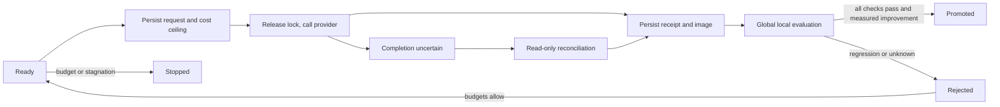

# Durable correction loop (D6)

The pure `core.correction_loop` models, transitions and acceptance policy are
separate from the installable engine's filesystem/runtime adapters. A trusted
host configures `meshvenn_engine.loop_runtime.LoopRuntime` with a durable workspace
and optional generation/evaluation ports. No provider, credentials, native ImageGen
access or quota is discovered implicitly.



## Trusted host and public operations

```python
from meshvenn_engine import MeshvennEngine

engine = MeshvennEngine(
    loop_workspace="/trusted/local/loop-store",
    generation_provider=my_service_adapter,  # optional, constructor only
    loop_evaluator=my_local_global_evaluator,
)
created = engine.execute("corrections.loop", {
    "operation": "start", "session_id": "character-review-1",
    "payload": {"accepted": accepted_snapshot.to_dict(), "artifacts": sha_to_base64},
})
engine.execute("corrections.loop", {
    "operation": "advance", "session_id": "character-review-1",
})
```

`LoopSnapshot` carries the complete `ViewSetRevision`, current diagnostic reports,
objective measurements and role-labelled artifacts (`glb`, `source_state`, etc.).
Every referenced image, mask and delivery artifact must be present in the CAS,
either in `start.artifacts` or preloaded by `artifact_put`. Artifacts are identified
by SHA-256, not arbitrary client filesystem paths.

The single versioned action `corrections.loop` and MCP tool `meshvenn_loop` expose:

| Operation | Payload | Meaning |
| --- | --- | --- |
| `start` | `accepted`, optional blobs, budget/policies/annotations | Save immutable starting evidence and compute local plans. |
| `status` | empty | Read the durable state without generation. |
| `advance` | optional `plan_id` | Perform one reserved submission or one global evaluation. |
| `resume` | empty | Drain saved receipts/evaluations and reconcile pending work without blind resubmission. |
| `cancel` | empty | Persist cancellation; keep accepted data and later receipts. |
| `supply` | bound receipt and optional blobs | Host-tool outcomes only, never caller-supplied evaluation verdicts. |
| `artifact_put` | base64 bytes, optional expected SHA | Save bounded immutable evidence. |
| `artifact_read` | SHA, offset, limit | Read a verified bounded chunk. |

The MCP CLI's existing trusted `--workspace` configures an `engine-loops`
subdirectory. Paths, service callbacks and evaluator objects cannot be supplied
through tool arguments. Session IDs use `[A-Za-z0-9][A-Za-z0-9_-]{0,127}`.
Windows long workspace paths and full-length IDs are supported and tested.

Runtime responses are strict `LoopState` JSON plus derived `known_cost` and
`cost_uncertain`; remove those two transport fields before `LoopState.from_dict`.
`verification_status` always remains `unknown`: a completed control operation or
a simulated promotion is not an asset-quality certificate. Reports, decisions,
scope and simulation metadata remain inspectable separately.

## Provider boundary and cost

`GenerationProvider.metadata()` returns strict `ProviderInfo`. Its `submit` and
optional `recover` receive a `GenerationRequest`, an artifact-reader callback,
a bounded timeout and cooperative cancellation. They return `ProviderResult`
containing a bound `ProviderReceipt` and immutable artifact bytes. Receipts record
the actual reported provider, model, parameters, operation ID and cumulative
request usage. Successful responses from another model, parameter set or cost
unit are retained as rejected receipts and cannot authorize evaluation.

An explicit `host_tool` provider can be declared at `start` when no service port
is injected. `advance` then returns an `awaiting_host` outbox; the engine executes
no native tool. The host invokes its own tool and uses `supply` to return the
receipt. The request exposes its fingerprint and idempotency key for exact echo.
Service API receipts instead come from the configured trusted callback.

A provider must declare a per-request cost ceiling in the same unit as the
budget before an effect can be reserved. A host that cannot know native-tool
pricing/quota must leave it unknown, rather than inventing free usage. Explicit
host invocation-count units can bound tool invocations; they do not establish
monetary cost or access to another product's quota. Unknown actual usage remains
unknown and prevents another generation; it is never added as zero-cost success.
Duplicate/pending acknowledgements cannot erase a known completed charge.

Defaults bound the loop to three attempts, 300 elapsed seconds, one configured
cost unit, two attempts without accepted progress and three recovery queries.
The default unit is USD. Reservations include their declared maximum charge;
actual overrun is retained and stops further work. The clock starts before
session setup and remains persisted across restarts. Backward clock movement,
elapsed budget and stalled improvement stop correction work.

## Crash, concurrency and late work

The state commits a request identity **before** the runtime releases its lock and
calls a provider. Only the caller that obtained that reservation dispatches it.
Concurrent `advance` requests cannot both submit the same operation. OS locks
protect state updates across processes, not just Python threads.

A crash or exception after reservation cannot prove that no paid operation
occurred. Resume first checks durable inboxes and records completion uncertainty.
If supported, it calls only the provider's read-only recovery operation, with a
bounded query count. It never blindly calls `submit` again, even when a provider
advertises idempotency. A conclusive `not_submitted` outcome requires receipt
evidence and measured zero cost; `unknown` or ordinary lookup absence is not that
proof. A new session is a new explicit intent, not a recovery shortcut.

Receipts are saved in a deterministic durable inbox before being applied to the
main session. Evaluation output is saved similarly before promotion. A crash in
either gap can replay completed work without another paid submission or another
completed evaluation. Invalid receipts are audited once and do not poison later
valid recovery. All receipt artifacts are immutable, including late responses.

Cancellation and budget stops preserve accepted images, source artifacts and GLB
bytes. A provider may still finish after cooperative cancellation; its output
and actual usage are retained, but it cannot promote a candidate. Read-only
reconciliation can collect usage after a stop without resetting the correction
deadline or making another paid submission. Arbitrary in-process callbacks cannot
be forcibly killed safely: adapters needing a hard wall deadline must isolate
their service/worker work and implement recovery.

## Global acceptance

`GlobalEvaluator` is a trusted replayable local port without paid or destructive
side effects. It receives the exact request and actual provider image and returns
`EvaluationResult` with a complete `GlobalEvaluation`, new snapshot and artifact
bytes. A paid remote judge requires its own explicit budgeted/idempotent adapter;
it must not hide a paid retry inside local evaluation.

The default policy requires D2/D3/D4 engine evidence, identity, camera compliance,
healthy constraints and exact-export verification. Every report must be current
for the candidate's full view set, complete, and have no required failure or
unknown. The evaluator must identify every checked view. Explicit required regions
cannot disappear from the checks. The export check must reference the exact
candidate GLB artifact, not another source or a generic score file.

Promotion additionally requires improvement of a comparable named objective
(`target_error`, normalized error, lower by at least .01 by default). A higher
mean IoU cannot vote away a missing part, identity drift, incomplete checks or an
unknown required result. Canonical-reference provenance is unchanged; the
provisional mesh never becomes identity authority. Other views, target camera,
alignment, source dimensions and full derived lineage are protected.

The runtime compares original/candidate PNG pixels outside the requested region
or supplied edit mask. It never fabricates a mask from a rectangle. Unsupported
source decoding remains unresolved and cannot pass preservation. Normalize other
formats through a trusted image adapter while retaining original photographs as
immutable evidence. Assessment may finish after the generation deadline if the
provider response was timely and the overall session budget still allows it.

Only after all checks pass does the accepted pointer move to the candidate and
the session stop with `accepted_improvement`. Rejection leaves it unchanged and
may try another bounded candidate. This is copy-on-write rollback, not editing
accepted files and trying to repair them afterward.

Without a configured provider or evaluator, local reports and D5 plans remain
usable, but the loop cannot claim a completed correction. The frozen D6 corpus
qualifies orchestration with explicitly simulated ports and one real D2/D4
reevaluation that remains unknown without required identity/global evidence.
No real provider or human semantic quality is qualified here; #84 remains open.
See [persistence guarantees](correction-loop-persistence.md) and
[the independent corpus](correction-loop-corpus.md).
