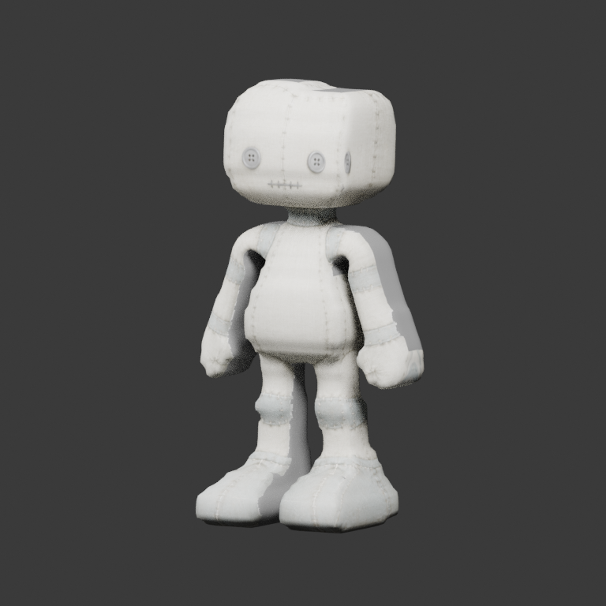

# Workshop doll: distal native chains

This separately selectable successor to
[StytchDollShoulderAligned](../StytchDollShoulderAligned/README.md) removes small
foreign skin influences from distant authored limbs. Existing same-chain weight
ratios are preserved. The explicit **Isolate Distal Limb Skin** command keeps the
body, shared interfaces, already isolated rows and the preceding attachment
collars exact; it fades to the existing native chain beyond those collars.
It changes 597 of 7,128 source vertices, with no geometry, UV, texture, rest-joint
or socket edit. Earlier bundles remain unchanged.

| Shoulder-aligned baseline, Hall | Distal-chain candidate, Hall |
| --- | --- |
|  |  |

## Measured benefit and limits

The old distant leg rows retained up to 1.52% foreign influence. In isolated
±90-degree thigh-root rotations, the right-leg rigid-chain residual reached
15.50 mm on the 1.82 m doll (left leg: 11.98 mm). Eight root-rotation probes now
have residuals below 0.00041 mm, including the already isolated arms. This
corrects unintended drift; ordinary elbow/knee bending remains a multi-bone skin.

The 32 isolated hip, knee and elbow controls retain the same frozen rest-edge
cohorts. Their worst and p95 absolute log length strain stay within 1% of the
baseline, plus a 1e-4 arithmetic allowance, without increasing the fraction of
edges compressed below 0.25 of rest length. There is a real tradeoff: the most
compressed right-knee edge at −90 degrees changes from 0.24075 to 0.23921.
This candidate does not improve every articulation metric or solve the folds.

Nineteen replays reuse the exact
[fresh shoulder-aligned Stytch matrices](../../poses/StytchDollShoulderAligned/README.md).
Their rests and binds are unchanged, so no pose derivation or pose repair is
needed. Source, raw decoded GLB and reimport stay within the existing fidelity
limits; protected vertices and the frozen torso cohort are separately checked.
Visible hip worst strain does not increase beyond 1e-4. Present-owned joint
cohorts bound worst strain to +1% and forbid additional collapsed fraction;
their p95 measurements remain diagnostic and may redistribute. Full hip and
all six visible joint-ball measurements are retained too, including neighboring
geometry near a hidden joint. A hidden limb's location is not represented as
quality evidence for that absent limb.

These matrices target the **preceding GLB**, not this new candidate. The candidate
has not been selected, captured or artistically accepted in Stytch. Own Blender
front/back comparisons of Hall, held, Walk-02 and Hop-11 are the sixteen pinned
PNGs; no private application screenshots are published. The Hop rear view makes
the folded leg visible without claiming that its shape is resolved. In the World
capture the absent right thigh still rotates about 120 degrees relative to rest;
pose admissibility and consumer world squash remain to be qualified separately.
The original atlas's neutral fallback/UV overlap, elbow/knee fit and absent-limb
open seams remain. Issues #60 and #63 remain open; expansion stays paused.

## Source and export

The contract remains 18 native joints, five regions, eight sockets, 7,126 quads /
14,252 triangles and zero clips. No Rebuild preserves the selected new source's
weights with unchanged source/raw/reimport gates. A separate before/after proof
allows only the declared edited positions; geometry keys, inverse binds, atlas,
and weights everywhere else are exact. Its tiny source-position projection
allowance maps authoring points to float32 GLB keys; it does not permit geometry
changes. The ordinary unchanged-source comparison correctly rejects old versus
new weights.

The production transaction rejects shared/nonlocal, animated, posed or ambiguous
sources and repeated edits. It stages a disposable mesh datablock and restores
the original pointer, weights and properties exactly on failure. The preceding
body/shoulder records are historical stages, not a claim that this successor's
whole skin still equals those stages.

| Item | SHA / revision |
| --- | --- |
| `character.glb` | `58bb85ca53f4bc437b7eb62777ea2d25aeb84aee7b46c4a53f837a507f89849b` |
| `source.blend` | `c02f6e29fc215366f891e75f4179e519aeaaa665f5b4feac6c7a41d8d237ae33` |
| Source authority snapshot | `7867eecfe112bf2087a7a04e94984d2bf529c7545ac93ad26b97c22fa6d4b843` |
| `pose-quality.json` | `9fb4d7e856040dcf2d06e5a9dcdca3019d1f98f2cbb1f469f00ce5fb42f484ce` |
| `edited-source-positions.json` | `026581b0d23c5f873ac1499a1b271b29b4d7638029b0af31c3aa1393a8b33633` |
| Generator commit | `a990a163a7845c03a8d3c99f5aa70b5e866527f4` |
| Captured baseline GLB | `6654f85acb539e471ccc525f4ffc029409e96e98aeb524df1be95211e860d3f8` |
| Fresh captured pose index | `e2285869ae4e5237791ada40bc1b0cc6253d324c120aad1b97e1fb9b7d2ead32` |
| Stytch capture revision | `a760e57a08d526088632b8cd269c391deeb3ecfb` |

JSON uses UTF-8 LF. Authoring, partition and reference bytes equal the preceding
bundle. Relocate `source.blend` together with `authoring.json`; packed images and
relative paths support No Rebuild. The relocation test compares the re-export
with this candidate and requires zero weight and inverse-bind error.

Reproduce into a fresh directory with Blender 5.2.1:

```bash
blender --background --factory-startup --python-exit-code 1 \
  --python scripts/refine_workshop_limbs.py -- \
  --output /tmp/distal-chains --source-sha <exact-generator-commit>
blender --background --factory-startup --python-exit-code 1 \
  --python tests/blender_limb_refinement_smoke.py -- \
  --variant /tmp/distal-chains --output /tmp/distal-verification
```
