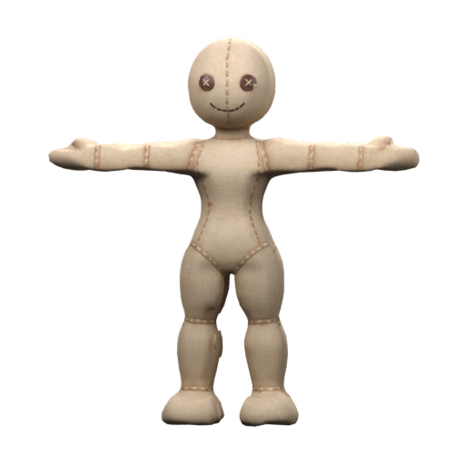

# Modular cloth dummy — producer candidate

This new version reduces the existing 39,804-triangle cloth dummy to **17,512
triangles**, with five authored regions and eight native joint-local sockets.
The three embedded 2048² fabric maps are byte-identical to the full-body
reference. The eighteen joints and disabled normalization are retained.

- [GLB](character.glb): SHA-256 `2df4fcf7d51efb20fe91d75975f8b61fdf4194ca122fdcbeaab65cfb74b97c29`.
- [Editable source](source.blend): SHA-256 `5cd525a32008ca0b9b5c92562cc4c7bc8d22baf2562fd368332b875b015e207d`.
- [Manifest](manifest.json), [frozen face/landmark choices](partition-authoring.json),
  [export contract](authoring.json), [provenance](provenance.json).
- [Scope and reproduction](../../../../docs/cloth-modular-source.md),
  [numerical evidence](evidence/), [retained failures](evidence/rejected-candidates.json).

| Producer check | Result |
| --- | --- |
| Source/LOD, 8 exact reference captures + 16 native probes + rest | Max <4.776 mm; p99 <1.454 mm; native elbow/shoulder profile passes |
| Public GLB import and No Rebuild | Pass; 17 rest/native probe states |
| Material transport | All three embedded images and shader semantics preserved |
| Four matched render views | Silhouette IoU >0.998; interior linear RGB RMSE <0.0163 |
| General visual and Stytch gameplay admission | **Not admitted** |

These are fidelity checks to the source, not a claim that its arm creases have
been fixed. Stytch independently recaptures from this exact new identity/rest
rig. Walk/Hop, missing regions, equipment, contacts and rights remain consumer
gates in [#103](https://github.com/Slimtrat/Meshvenn/issues/103). Collision proxies
and Jolt qualification remain [#100](https://github.com/Slimtrat/Meshvenn/issues/100).
No old library entry or frozen full-body file is replaced.

The seam contract is `open-shared-vertices`: whole faces belong to exactly one
region; there are no invented caps. Source topology observations (including
24 nonmanifold edges) remain disclosed. Source sheets are generated images,
with no calibrated cameras or 3D ground truth.

The repository licence declaration is carried in provenance. **An explicit
asset-family grant and consumer rights review remain unrecorded/pending**;
the code licence is not treated as an automatic new grant over every generated
input or delivery. See [LICENSE-NOTICE](LICENSE-NOTICE.txt).
