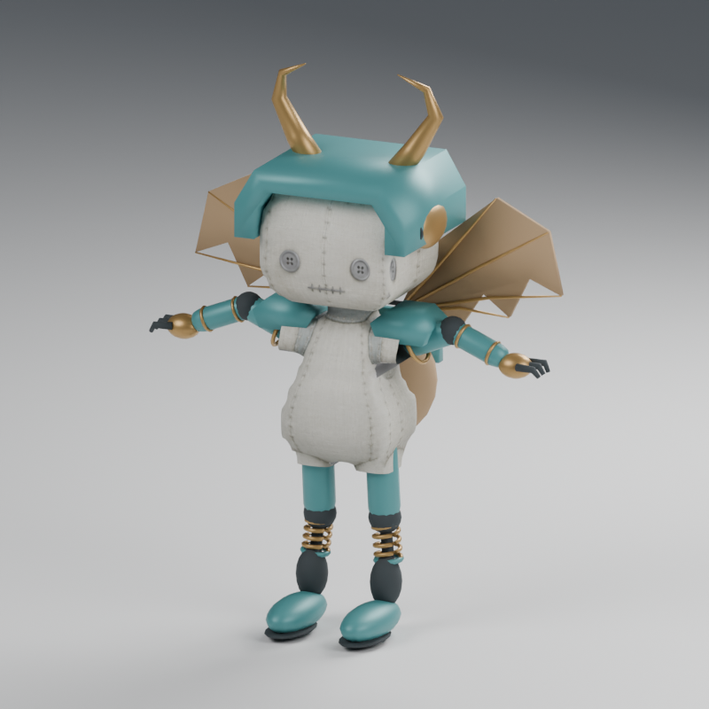
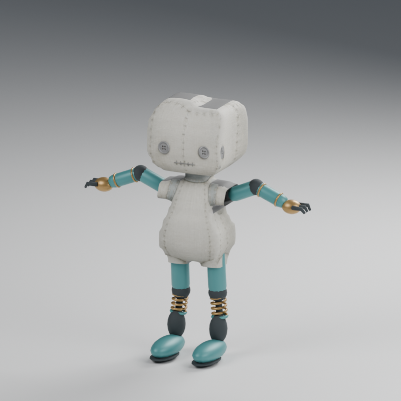
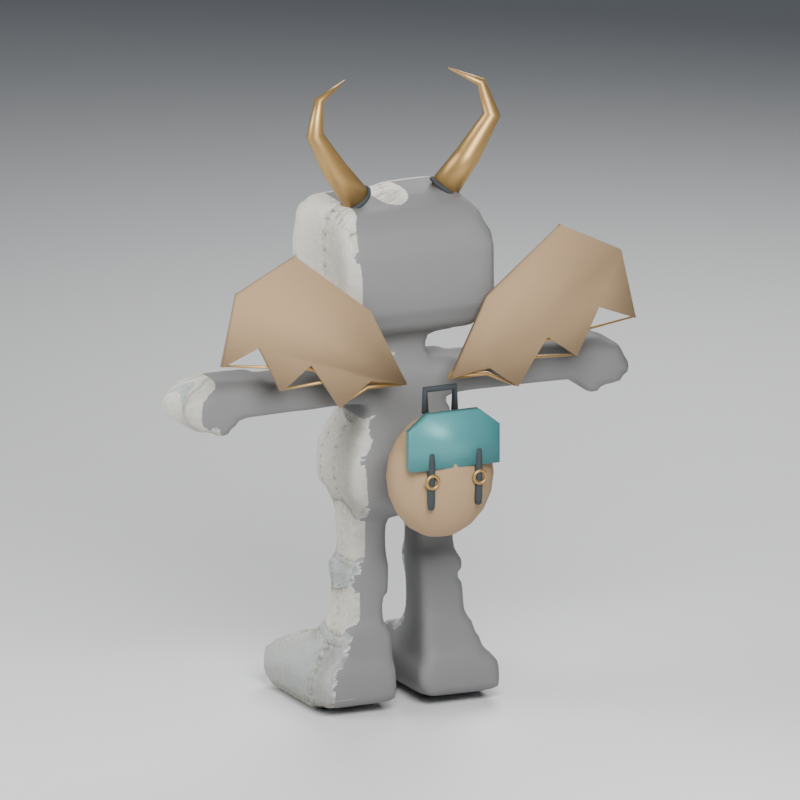

# Stytch Workshop Modules V1

Ten original, editable pieces in three families, fitted to the public
`StytchDollDistalChains` character. The palette combines teal enamel, aged brass,
dark rubber and canvas. There is no torso replacement; the chest stays available
for identity and gameplay-owned artifacts.



| Family | Pieces | Effect on the original skin |
| --- | --- | --- |
| Equipment | Open headguard, left/right shoulder shells | Added over the existing body |
| Replacement | Left/right grip arms, left/right spring legs | Hide only the corresponding original region when selected |
| Accessory | Curled horns, canvas glider wings, field backpack | Added over the existing body |

The arms and legs use the actual three-joint native chains. Each closed component
is rigidly weighted to its anatomical segment; the visible elbow, knee and ankle
interfaces articulate instead of stretching the metal or canvas. The wings are a
rigid accessory, without a new wing skeleton or flight animation.

| Articulated replacement limbs | Rear accessories |
| --- | --- |
|  |  |

## Delivery

- `pack.json`: stable IDs, owners, replacement regions, files and SHA-256,
  original 18-joint rest/bind profile, normalization and public socket transforms.
- `skinned/`: ten standard GLBs, each with one module mesh, the complete unchanged
  native skin and zero clips. These files contain no hidden whole character.
- `attachments/`: six static alternatives for equipment/accessories, with one
  mesh and no skeleton. Their coordinates are already in the declared original
  joint/socket-local frame. Parent with **identity**, inheriting the original
  normalization; do not apply another facing, scale or legacy surface offset.
- `source.blend`: all ten editable module meshes, the original native rig and
  the original doll as a reference. Packed reference images are retained.
- `validation.json`: triangles, draw primitives, 72 isolated ±45/90-degree native
  pose probes, source/raw/reimport errors and exact static-attachment placement.
- `godot-validation.json`: actual Godot importer/adapter acceptance, one retained
  native skeleton and 160 owner-presence checks.
- `previews/`: six renders of the exported GLBs reimported into Blender, including
  the three separate families, rear accessories and an articulated loadout.

The target is pinned to character SHA-256
`58bb85ca53f4bc437b7eb62777ea2d25aeb84aee7b46c4a53f837a507f89849b`.
The original character, weights, textures, rests, binds and eight-socket ABI are
not replaced by this pack. These assets do not certify motor contacts, physical
collisions, mobile performance or final artistic acceptance.

## Connect in Stytch / Godot

The downloadable ZIP includes `godot_module_adapter.gd`. This independent asset
adapter mounts a selected GLB onto the **existing imported native Skeleton3D**.
It checks the selected character hash, asset bytes, joint names, hierarchy,
rest/normalization and inverse binds. It gives each installation its own material
overrides, transfers only the module mesh and frees
the temporary imported rig. Invalid or duplicate installations return an error
without changing the native character. No engine-core dependency is added.

```gdscript
var result = MeshvennWorkshopModules.mount_skinned(
    imported_avatar_root, native_skeleton, "res://WorkshopModules",
    pack, "grip-arm-l", selected_character_sha256)
if not result.ok:
    push_error(result.error)
    return
MeshvennWorkshopModules.apply_presence(result, current_region_presence)
```

`imported_avatar_root` is the original GLB scene root, containing its unchanged
normalization hierarchy. `current_region_presence` is supplied by the consumer,
with explicit booleans for `body-core`, `left-arm`, `right-arm`, `left-leg`, and
`right-leg`. The adapter never changes the skeleton rest or guesses anatomy.

For a replacement, Stytch must hide the base mesh named by `replaces_region`
while that selected module is active and its owner is present. Removing the
module restores that base region only when the Core presence frame allows it.
Damage, breakage, mass, capability effects, catalog IDs and loadout persistence
remain Stytch's responsibility. These are asset IDs, not new Core equipment
definitions. The pack is tested through the adapter; it is not automatically
enabled in the private Stytch game.

Static alternatives are optional. Headguard/horns use `attach-head`, wings use
`attach-wing`, and the backpack uses `attach-backpack`. Shoulder shells use the
explicit `upper_arm.L/R` joint frames; they do not misuse the existing hand
sockets. `binding.rest_mount_world` records the authored placement in the glTF
rest frame, for independently checking consumer placement.

## Edit and reproduce

Open `source.blend` on the complete loadout, select an object in **Stytch Workshop Modules**, and
edit its mesh, materials, UVs or native vertex groups. Keep its stable
`meshvenn_workshop_module` custom property. Keep the original body reference and
native rig unchanged. Weights must be normalized, with at most four existing
deform bones per vertex. Equipment/accessory static variants require their one
declared parent joint. Apply non-armature modifiers before re-export; shape keys
and animation are outside this static module pack.

Portable re-export from the ZIP, requiring Blender 5.2.1 but no Meshvenn engine
or installed Sketch add-on:

```sh
blender --background --factory-startup --python-exit-code 1 \
  --python Source/author.py -- --from-blend source.blend --output ../edited-pack
```

The command requires a fresh output directory and exports the saved meshes; it
does not regenerate them or overwrite the previous pack. Keep `pack.json`
beside the `.blend`. Copy the README/adapter from this delivery when handing off
an edited pack, then rerun the repository gates before publishing it.

Fresh generation from this checkout:

```sh
blender --background --factory-startup --python-exit-code 1 \
  --python extensions/meshvenn_sketch/examples/stytch_workshop/author.py -- \
  --output /tmp/workshop-modules
blender --background --factory-startup --python-exit-code 1 \
  --python extensions/meshvenn_sketch/tests/blender_workshop_smoke.py -- \
  --pack /tmp/workshop-modules
blender --background --factory-startup --python-exit-code 1 \
  --python extensions/meshvenn_sketch/examples/stytch_workshop/render.py -- \
  --pack /tmp/workshop-modules
python scripts/prepare_workshop_godot.py --pack /tmp/workshop-modules --output /tmp/workshop-godot
godot --headless --path /tmp/workshop-godot --editor --import
godot --headless --path /tmp/workshop-godot --script check.gd
```

Pack the committed, validated delivery with
`python scripts/build_stytch_workshop_pack.py`. It produces
`dist/stytch-workshop-modules-v1.zip`, including the source scripts, adapter,
editable scene, GLBs, reports, previews and GPL-3.0-or-later license.
