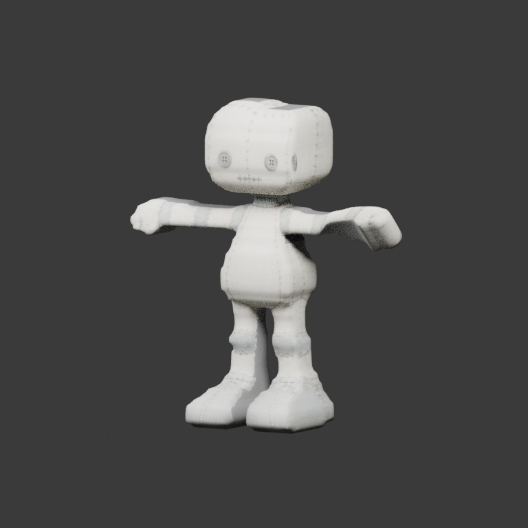
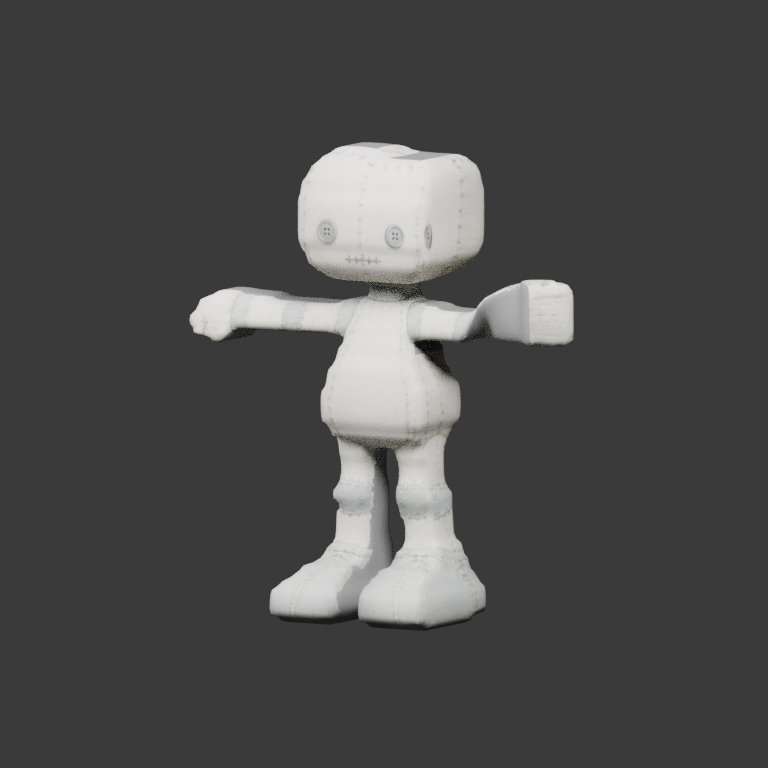
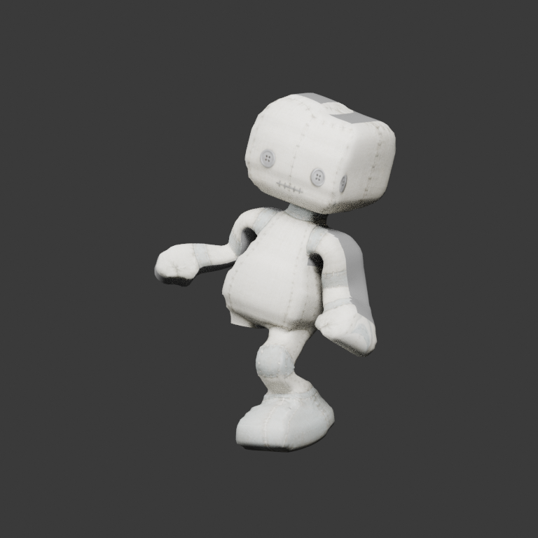
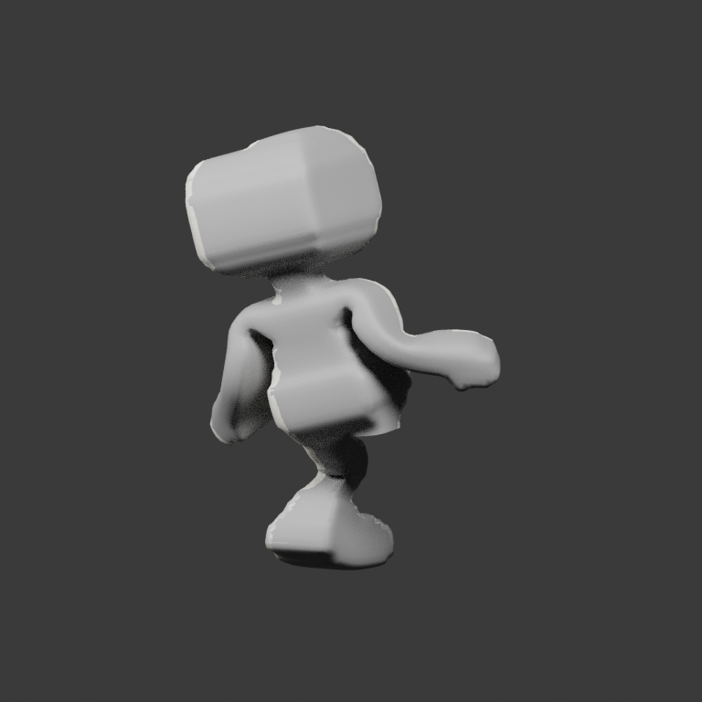

# Selected distal skin: actual Stytch elbow and production replay

Stytch PR #227 explicitly selects the unchanged
[StytchDollDistalChains bundle](../../modular/StytchDollDistalChains/README.md)
at revision `1503d4854c991335027255f79c42788954abcfbf`. This is actual consumer
evidence of that exact delivered asset. It follows Stytch's coupled Hop support
and shoulder/elbow/wrist target corrections; earlier frozen poses are retained
as historical controls rather than treated as current target commands.

The dataset contains **nineteen production captures plus four isolated native-local
elbow captures**: left/right at 45 and 90 degrees. Each JSON and paired private
PNG was checked against its Git blob/hash before projection. Only authorized
matrices and provenance are published in `complete/`: 23 probes, 23 redundant
matrix proofs and the pinned index. Private screenshots, videos, controls,
loadouts, world telemetry, ancestor node names and consumer code are excluded.

## What the poses exercise

| Context | Captures | Maximum visible left/right elbow rotation | Interpretation |
| --- | ---: | --- | --- |
| Isolated elbows | 4 | 90.000° / 90.000° | Actual 45/90-degree excitation, opposite forearm at rest |
| Hop | 12 | 76.000° / 76.272° | Both forearms move in the combined Hop |
| Walk | 3 | < 0.0001° / < 0.0001° | Forearms remain essentially at local rest |
| Held | 1 | < 0.0001° / < 0.0001° | Forearms remain essentially at local rest |

The 5-degree inventory threshold measures rotation amplitude only. Overall
excitation completeness cannot qualify every action family: Hop and isolated
controls do not fill the Walk/held gaps. `motion_context_coverage` therefore
keeps production, isolated-elbow, Walk, held and Hop summaries separate.
One excited pose does not establish a supported range or visual quality.

The four elbow claims are checked against complete native `inverse(Rest) * Pose`
deltas, within 0.05 degree of their requested/measured annotation. Both arm regions
must be visible and the opposite forearm must remain within 0.05 degree of rest.
Public annotations are rechecked from the projected matrices in CI, without
private inputs. Wrong side/angle/presence, nonrigid/mirrored transforms, corrupted
proofs, PNG mismatches and changed lineage fail before publication.

## Source and export findings

All 23 cases pass unchanged native-source / raw-GLB / reimport transport gates.
Maximum source/raw error is **1.086e-6 m**; raw/reimport **9.099e-7 m**. Source
authority and the captured native rest frame remain unchanged. No new mesh,
weights, rest joints, material, authored regions, sockets or clips are delivered.

| Actual left elbow at 45°, own GLB render | Actual left elbow at 90°, own GLB render |
| --- | --- |
|  |  |

| Current combined Hop, own front view | Same matrices, own back view |
| --- | --- |
|  |  |

`source-articulation.json` freezes rest-joint centres and 0.12-height surface-edge
balls for both elbows, hips and knees. Full-mesh measurements remain diagnostic;
body-plus-owned-limb cohorts are reported only while that limb is present. Hidden
joint rotations cannot earn silhouette credit. The source object and pose state
must restore exactly after measurement. These edge metrics do not certify
anatomy, volume, self-intersection or physical contact.

The compressions visible in the native source are faithfully transported by GLB;
this excludes a transport discrepancy for these samples, not every possible
source-versus-target anatomical cause. Local pivot-centering/weight-softness
experiments improved some isolated metrics but worsened other controls or
combined Hop folds. They are not shipped. The original atlas fallback/UV overlap,
missing-limb seams, source joint fit and artistic acceptance remain unresolved.
Source edits must be qualified on the current poses and the retained bilateral
stress controls before a new asset is selected.

The 41 PNGs in `replay/` are **own Blender renders**. Eight cases include evaluated
visible front/back views; cameras and lights cannot change the pose or material.
These are asset-local reviews, before consumer ancestor facing/placement/squash,
not pixel matches with private application captures. `visual_qualification=false`
and `consumer_acceptance=false` remain explicit.

## Pins and reproduction

| Item | SHA / revision |
| --- | --- |
| Selected GLB | `58bb85ca53f4bc437b7eb62777ea2d25aeb84aee7b46c4a53f837a507f89849b` |
| Editable source | `c02f6e29fc215366f891e75f4179e519aeaaa665f5b4feac6c7a41d8d237ae33` |
| Source authority | `7867eecfe112bf2087a7a04e94984d2bf529c7545ac93ad26b97c22fa6d4b843` |
| Captured pose index | `c6a753c04cab1818f420df283af833c9dc19e27251350cd3ab4cec8b83b5d000` |
| `replay/series.json` | `c786f4f9d83e0e997b35b91b5b6aac3d462942a268797d508487914bd168dbd9` |
| `source-articulation.json` | `0c060b4248acda6780040ae75c3f422956cb931c748129e25916494ca5a174c9` |
| `articulation-coverage.json` | `48069d95cc49c52962024317b3fa81ee0dc8ecfaf8ee7c945c0c419a0fc59990` |
| Generator code | `7f94f38d8c18a7b0aff429e19066f4d5d18939a7` |
| Stytch capture revision | `1503d4854c991335027255f79c42788954abcfbf` |

All new JSON is UTF-8 LF. Earlier source bundles, capture indices, derived poses
and generation-time acceptance records remain immutable. The producer's older
`consumer_capture_targets_candidate=false` describes its old inputs; it does not
negate these later selected-asset captures or establish artistic acceptance.

Reproduce from the public inputs with Blender 5.2.1, into fresh output paths:

```bash
blender --background --factory-startup --python-exit-code 1 \
  --python scripts/replay_stytch_pose_series.py -- \
  --profile distal-chains --review-views \
  --render-cases Elbows-meshvenn-elbow-left-45 Elbows-meshvenn-elbow-left-90 \
    Elbows-meshvenn-elbow-right-45 Elbows-meshvenn-elbow-right-90 \
    factory-hall factory-held Walk-meshvenn-walk-02 Hop-meshvenn-hop-06 \
  --output /tmp/distal-replay --source-sha <exact-code-commit>
blender --background --factory-startup --python-exit-code 1 \
  --python scripts/analyze_stytch_articulation.py -- \
  --profile distal-chains --output /tmp/distal-source-articulation.json \
  --source-sha <exact-code-commit>
python scripts/report_stytch_pose_coverage.py --profile distal-chains \
  --output /tmp/distal-coverage.json --source-sha <exact-code-commit>
```

The explicit `distal-chains` profile binds its 23 cases to one source revision,
blob set, asset and qualified index. Historical profiles remain 19-case profiles;
the default original replay is unchanged. V2 CI regenerates this selected-asset
replay and frozen source review in its existing evidence artifact. The job's time
ceiling increases to accommodate the added work; fidelity thresholds are intact.

Stytch owns applying the anatomical arm chain to Walk/held and later feet-ground,
weight and landing behavior. MeshVenn owns source deformation review and any
separately fingerprinted correction. Issues #60 and #63 remain open; capability
expansion and artistic acceptance remain separate gates.
