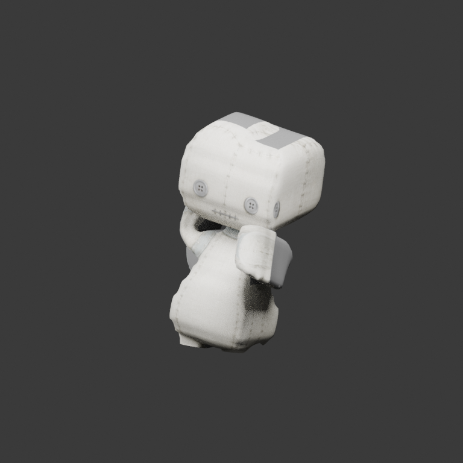
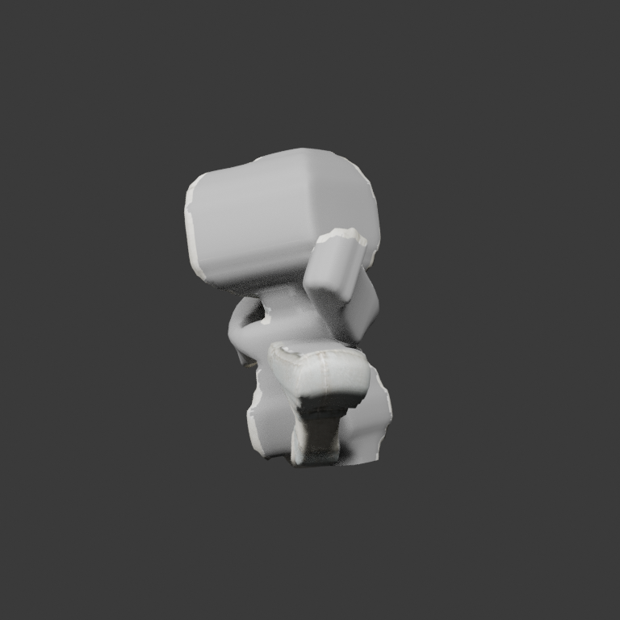

# Actual consumer replay of the shoulder-aligned doll

This is the **fresh captured** pose set supplied by Stytch
[PR #225](https://github.com/Stytch0/Stytch/pull/225), revision
`a760e57a08d526088632b8cd269c391deeb3ecfb`. It targets exactly the delivered
`StytchDollShoulderAligned/character.glb`, SHA-256
`6654f85acb539e471ccc525f4ffc029409e96e98aeb524df1be95211e860d3f8`.
It does not replace the original doll's captures or the earlier **derived** poses.
No source GLB, Blend, weight, rest, material, region or socket is edited here.

`complete/` contains nineteen probes, nineteen redundant matrix proofs and their
index. Capture JSON Git blobs are pinned before projection; every original PNG
hash is verified locally before extracting the whitelisted matrices/provenance.
Original private PNGs, code, controls, loadouts, node names and world telemetry
are **not** published. Publication of matrices/provenance was authorized by the
source owner. All public JSON uses UTF-8 LF.

The cases are Hall, held, missing-left-leg Hall, three Walk frames, twelve
mono-leg Hop frames (right leg absent), and one world approach frame. The latter
is a Walk approach despite its historical `one-leg-hop` filename; this fresh
capture has **both right arm and right leg absent**, which the replay retains.
Each complete parent-local `Pose` already includes its rest frame, not a delta.

## Reproduction and pinned results

```bash
python scripts/extract_stytch_pose_series.py --profile shoulder-aligned \
  --input /private/authorized/factory --output /tmp/fresh-capture-projection
blender --background --factory-startup --python-exit-code 1 \
  --python scripts/replay_stytch_pose_series.py -- \
  --profile shoulder-aligned --review-views \
  --render-cases factory-hall factory-held Walk-meshvenn-walk-02 Hop-meshvenn-hop-11 \
  --output /tmp/fresh-consumer-review --source-sha <exact-replay-generator-commit>
```

Use separate fresh empty output directories. Without `--profile`, both tools
retain the immutable original-doll behavior and its original qualified index.
Cross-generation assets, raw input edits, proof corruption, PNG mismatches and
unqualified index bytes are rejected, not silently rebound to the selected rig.
CI reruns both generations separately and publishes only its own Blender renders.

The pinned local review in `replay/` passes all nineteen native-source / decoded
GLB / Blender-reimport comparisons at the unchanged fidelity limits:

| Item | Value |
| --- | --- |
| Maximum source/raw position error | `1.085741587303346e-6 m` |
| Maximum raw/reimport position error | `8.719407560420223e-7 m` |
| Capture index SHA-256 | `e2285869ae4e5237791ada40bc1b0cc6253d324c120aad1b97e1fb9b7d2ead32` |
| Replay report SHA-256 | `a1ad994cf8156d3f44e74782ade513094310b0fd4ec50fe488240f69cfd2cbdc` |
| Replay generator | `5871fbae8be4ae2d735468f466931e47f442da10` |

Twenty-one **own Blender renders** cover Hall, held, Walk and Hop. Front/back
review cameras frame evaluated visible skin only, with the same neutral light
rig rotated for the rear view. They never move a bone, repaint a material, add
caps or change visibility beyond the recorded absent regions. All posed mesh
positions must remain exact before/after the review cameras are added.

## What the clean views establish

| Hop 11, front | Same pose, rear |
| --- | --- |
|  |  |

The remaining left leg is present and folded behind the torso; the front view
occludes it. A single front screenshot cannot establish that the skin dropped a
region. The same compressed/folded pose is reproducible on the native source
before GLB export. This excludes an export-transport discrepancy for these poses,
**not** source-versus-target anatomical responsibility or artistic quality.

External consumer transforms remain distinct from native-local skinning. For
Hop 11, one captured ancestor has basis-column lengths approximately
`[1.064316, 0.922352, 1.048243]`; the next has uniform scale `1.0388`. Hall/held
do not have that nonuniform squash. The local bone deltas in these representative
cases have unit basis lengths to import precision. Ancestor recomposition is
validated, but this asset-local review deliberately excludes consumer world
facing, placement and animated ancestor squash. It is **not** a pixel comparison
with the private app or a claim to have qualified the final world presentation.

Next review should isolate hip/knee/forearm rotations and source skin behavior,
then assess the consumer's external squash separately. Do not move pivots or
reweight merely to cancel a target pose or a viewing occlusion. Extreme-pose
folds, legacy joint fit, atlas neutral fallback/UV overlap and open missing-limb
seams remain unqualified. Stytch reports technical native/PCK/physics integration
locally; its PR remains separate from this producer replay. No remote Stytch CI,
active motor, physics handoff or mobile qualification is implied.

`visual_qualification=false`. #60 and #63 remain open and capability expansion
remains paused; transport success is not full consumer/visual acceptance.

The subsequent [articulation coverage review](ARTICULATION.md) makes another
limit explicit: these nineteen captures leave both forearms at their local rest
rotation. Shoulder movement does not qualify elbow flexion, and hidden right-leg
rotation cannot qualify that absent limb. The separate pinned inventory and future
CI replay reports expose those gaps without changing this historical evidence.
